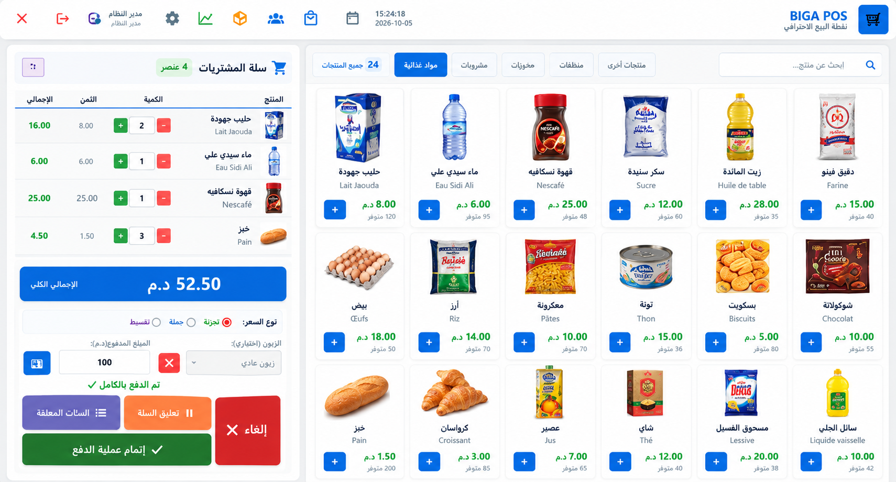
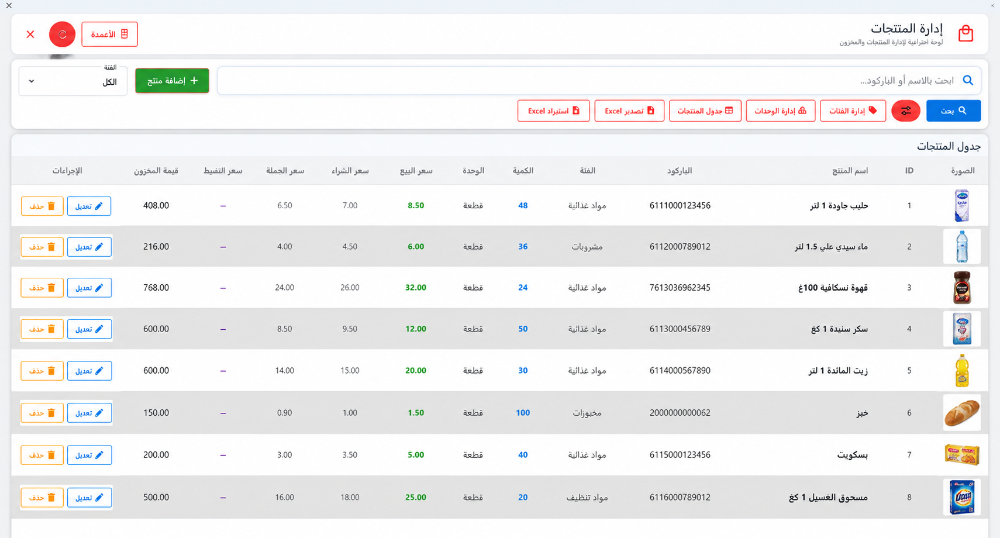
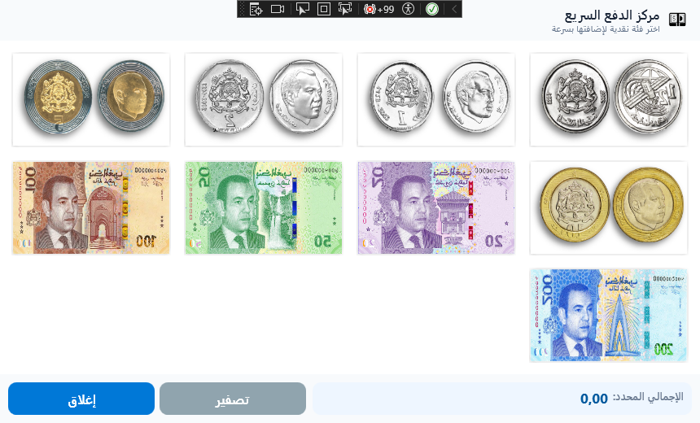
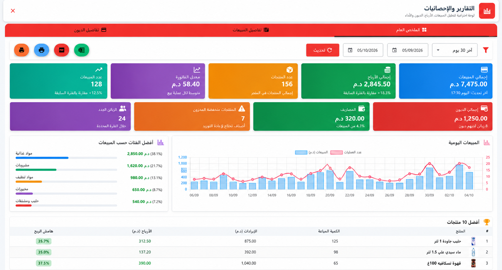

# POS_BIGA - Retail Point of Sale & Inventory Management System

A touch-optimized, enterprise-ready desktop Point of Sale (POS) and inventory management application built with **C#**, **.NET 10 (WPF)**, and **Microsoft SQL Server**.

---

## 📌 Overview

**POS_BIGA** is a desktop POS solution designed to handle retail sales workflows, inventory tracking, customer credit ledgers, thermal/PDF receipt printing, and financial reporting. 

Featuring native Right-to-Left (RTL) interface support, responsive touch-screen window scaling, and hardware barcode integration, the system is engineered to deliver reliable performance in high-frequency retail environments such as supermarkets, grocery stores, and commercial retail shops.

---

## 📸 Screenshots

| Main POS Checkout | Products & Inventory |
| :---: | :---: |
|  |  |

| Quick Cash | Reports & Analytics |
| :---: | :---: |
|  |  |

---

## ✨ Features

### 🛒 Point of Sale & Checkout
- **Touch-First Terminal:** Product category navigation with card layout, image caching, and responsive DPI scaling (`ResponsiveWindowBehavior`).
- **Barcode & Fast Search:** Debounced instant product searching by barcode, SKU, or name with auto-select and audio cues.
- **Multi-Tier Pricing:** Dynamic cart pricing allowing per-item selection between **Retail (تجزئة)**, **Wholesale (جملة)**, and **Installment (تقسيط)** rates.
- **Suspended Carts (Parked Sales):** Park active customer baskets to serve other customers and restore them seamlessly at any time.
- **Quick Cash Panel:** Currency denomination buttons (0.50, 1, 2, 5, 10, 20, 50, 100, 200 MAD) for rapid cash change calculations.

### 💳 Customer Credits & Flexible Settlement
- **Payment Methods:** Support for Cash, Card, Credit (الكريدي / الآجل), and Mixed split payments (part cash, part credit).
- **Credit Limit & Ledger:** Customer accounts with credit limits, real-time debt balance calculations, and history tracking.
- **Debt Settlement:** Dedicated payment collection interface with balance update receipts.

### 📦 Inventory & Stock Movement
- **Real-Time Stock Decrement:** Inventory automatically deducted upon checkout inside resilient database execution strategies.
- **Audit Ledger:** Detailed stock movement logging (`StockMovement`) tracking movements, prior balance, updated balance, timestamps, and staff attribution.
- **Low-Stock Alerts:** Visual threshold indicators for low-stock and out-of-stock items.
- **Units of Measure:** Configurable discrete units (pieces, boxes, dozens) and divisible/fractional units (kg, g, m, L) with sub-unit conversion ratios.

### 📊 Reports & Data Analytics
- **Financial Metrics:** Key performance indicators including Total Sales, Cost of Goods Sold (COGS), Gross Profit, Profit Margins, and Average Invoice Value.
- **Period Filtering:** One-click presets for Today, Yesterday, This Week, Last 30 Days, This Month, or custom date ranges.
- **Excel Export (`.xlsx`):** Native multi-sheet Excel reports generated via **ClosedXML** (Summary, Sales, Top Products, Categories, Debts) with RTL worksheet alignment.
- **PDF Generation:** Formatted invoices and statements generated using **QuestPDF**.

### 🖨️ Printing & Hardware Integration
- **Thermal Receipt Printing:** ESC/POS and FlowDocument support for 80mm and 58mm thermal receipt printers.
- **Standard Invoicing:** A4 and A5 document layouts with live WPF print preview.
- **Template Customization:** In-app visual designer for shop branding, headers, footers, tax information, and receipt layout options.

### 🔐 Security & User Administration
- **Role-Based Access Control (RBAC):** Configurable roles (`Admin`, `Cashier`, `Inventory`, `Viewer`) with 19 granular permissions.
- **Password & PIN Security:** BCrypt password and PIN hashing (`BCrypt.Net-Next`).
- **Database Backup & Recovery:** In-app SQL Server backup (`.bak`) and restore utility with automatic SQL Server service account permissions management.

---

## 🛠️ Technology Stack

- **Target Framework:** .NET 10 (`net10.0-windows7.0`)
- **Language:** C# 14
- **UI Framework:** Windows Presentation Foundation (WPF) with XAML
- **UI Components & Theme:**
  - `MaterialDesignThemes` (5.3.0)
  - `MahApps.Metro` (2.4.11) & `MahApps.Metro.IconPacks` (6.2.1)
- **Architecture:** MVVM pattern using `CommunityToolkit.Mvvm` (8.4.0)
- **Database & ORM:** Microsoft SQL Server with `Microsoft.EntityFrameworkCore.SqlServer` (10.0.3)
- **Security:** `BCrypt.Net-Next` (4.1.0)
- **Reporting & Documents:**
  - `ClosedXML` (0.104.2) for Excel generation
  - `QuestPDF` (2025.1.0) for PDF invoice generation

---

## 🏛️ Architecture & Project Structure

The project implements the **MVVM (Model-View-ViewModel)** architectural pattern with decoupled service, repository, and infrastructure layers:

```
POS_BIGA/
├── Assets/                 # Touch currency denomination graphics
├── Behaviors/              # Attached behaviors (ResponsiveWindowBehavior, TextBoxSelectAll)
├── Commands/               # ICommand implementations (RelayCommand)
├── Converters/             # XAML value converters
├── Data/
│   ├── AppDbContext.cs     # EF Core database context and model definitions
│   ├── Interfaces/         # Repository contracts
│   └── Repositories/       # Data repository implementations
├── docs/
│   └── screenshots/        # Application interface screenshots
├── Infrastructure/
│   ├── Excel/              # ClosedXML Excel report generation
│   ├── Helpers/            # Image storage sync and barcode helpers
│   └── Printing/           # Thermal/Document print engines and QuestPDF builders
├── Migrations/             # EF Core database schema migrations
├── Models/                 # Domain entities (Product, Sale, Customer, Credit, Inventory, User)
├── Resources/              # Global styles, palettes, and icon templates
├── Services/               # Business logic services (SaleService, UserService, BackupService, etc.)
├── Utilities/              # Data verification and utility tools
├── ViewModels/             # CommunityToolkit.Mvvm ViewModels
└── Views/
    ├── Controls/           # Reusable user controls (CheckoutControl, InventoryAdvancedStats)
    ├── Pages/              # Management views (ProductsPage, CategoriesPage, CustomersPage, UnitsPage)
    └── Windows/            # Application windows (MainWindow, LoginWindow, ReportsWindow, SettingsWindow)
```

---

## 🚀 Getting Started

### Prerequisites
- Windows 10 or Windows 11 (x64)
- [.NET 10 SDK](https://dotnet.microsoft.com/)
- [Microsoft SQL Server](https://www.microsoft.com/sql-server/) (SQL Server 2019+ or SQL Server Express / LocalDB)
- Visual Studio 2022 / 2025 (with *.NET Desktop Development* workload)

### Configuration
By default, the application connects to a local SQL Server Express instance:
```
Server=localhost\SQLEXPRESS;Database=POS_BIGA;Trusted_Connection=True;TrustServerCertificate=True;
```

To configure a custom database connection:
1. Copy `appsettings.example.json` to `appsettings.json`.
2. Update the `DefaultConnection` connection string with your SQL Server parameters:
   ```json
   {
     "ConnectionStrings": {
       "DefaultConnection": "Server=YOUR_SERVER;Database=POS_BIGA;Trusted_Connection=True;TrustServerCertificate=True;"
     }
   }
   ```
Alternatively, set the `ConnectionStrings__DefaultConnection` environment variable.

### Building & Running
1. Clone the repository:
   ```bash
   git clone <YOUR_GITHUB_REPOSITORY_URL>
   cd POS_BIGA
   ```

2. Restore packages and build:
   ```bash
   dotnet restore POS_BIGA.sln
   dotnet build POS_BIGA.sln
   ```

3. Run the application:
   ```bash
   dotnet run --project POS_BIGA.csproj
   ```

*(Database schema migrations are applied automatically on startup upon database connection).*

---

## 🔑 Demo Credentials

For local testing and portfolio evaluation, the application includes default demonstration credentials:

| Username | Password | Role |
| :--- | :--- | :--- |
| `admin` | `admin123` | System Administrator (Full Permissions) |

> ⚠️ **Notice:** These credentials are provided strictly for demonstration, evaluation, and local development purposes. In a production deployment, default accounts should have their passwords updated immediately through the User Management screen.

---

## 📄 License & Terms of Use

**Proprietary / All Rights Reserved**

Copyright (c) 2026 Biga. All rights reserved.

This repository is published publicly solely for portfolio display, technical demonstration, and evaluation purposes. Viewing the source code does **not** grant permission to copy, modify, redistribute, sublicense, deploy, or commercially use this software, in whole or in part, without explicit prior written authorization from the copyright holder.

For third-party library licenses and attributions, see [THIRD-PARTY-NOTICES.md](THIRD-PARTY-NOTICES.md).
